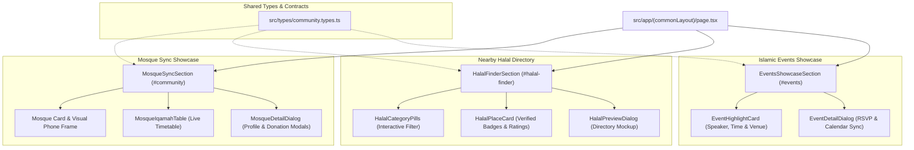

# System Architecture: Community Showcases (Phase 4)
`ARCH_community_showcases.md`

## 1. System Architecture & Component Flow



---

## 2. 3-Tier Component Reusability Strategy

| Priority Tier | Component / File Path | Reusability Role in Phase 4 | Customization / Extension Notes |
| :--- | :--- | :--- | :--- |
| **1st Priority (Universal Project Reuse)** | `src/components/ui/badge.tsx` | Status tags, category pills, verified Halal markers, Iqamah labels | Reused with `variant="outline"` and semantic color classes |
| **1st Priority (Universal Project Reuse)** | `src/components/ui/button.tsx` | Action buttons, modal triggers, category filter tabs | Standard primary and outline button variants |
| **1st Priority (Universal Project Reuse)** | `src/components/ui/dialog.tsx` | Interactive mockup modals (`MosqueDetailDialog`, `HalalPreviewDialog`, `EventDetailDialog`) | Standard accessible modal container with header and description |
| **1st Priority (Universal Project Reuse)** | `src/lib/utils.ts` | Dynamic class merging | `cn(...)` |
| **2nd Priority (shadcn/ui Components)** | Official shadcn primitives (`Badge`, `Button`, `Dialog`) | Modal overlays, responsive drawer actions | Zero ad-hoc dialog implementations |
| **3rd Priority (Custom Tailwind Components)** | Section layout containers, phone mockup frame styling | Responsive 2-column split grids with alternating visual hierarchy | Pure Tailwind CSS using semantic tokens from `globals.css` |

---

## 3. TypeScript Contracts & Mock Data (`src/types/community.types.ts`)

```typescript
export interface IqamahTime {
  prayer: "Fajr" | "Dhuhr" | "Asr" | "Maghrib" | "Isha" | "Jumu'ah";
  adhan: string;
  iqamah: string;
  isNext?: boolean;
}

export interface MasjidItem {
  id: string;
  name: string;
  arabicName: string;
  address: string;
  city: string;
  state: string;
  distance: string;
  imamName: string;
  iqamahSchedule: readonly IqamahTime[];
  donationChannel: {
    campaignTitle: string;
    description: string;
    category: string;
    verifiedDirect: boolean;
  };
  imageSrc: string;
  profileImageSrc: string;
  donationImageSrc: string;
}

export type HalalCategory = "all" | "restaurant" | "grocery" | "butcher";

export interface HalalPlaceItem {
  id: string;
  name: string;
  category: HalalCategory;
  categoryLabel: string;
  cuisine: string;
  rating: number;
  reviewCount: number;
  distance: string;
  address: string;
  certificationAuthority: string;
  isHandSlaughtered: boolean;
  isOpenNow: boolean;
  openingHours: string;
  priceLevel: "$" | "$$" | "$$$";
}

export interface IslamicEventItem {
  id: string;
  title: string;
  subtitle: string;
  dateBadge: string;
  timeString: string;
  venueName: string;
  venueAddress: string;
  speakerName: string;
  speakerTitle: string;
  category: "lecture" | "family" | "youth" | "fundraiser";
  admission: "Free Community Admission" | "Ticketed RSVP";
  highlights: readonly string[];
  imageSrc: string;
  detailsImageSrc: string;
}
```

---

## 4. Component Decomposition (< 300 Lines Each)

| Component File Path | Primary Responsibility | Reused Primitives | Est. Lines |
| :--- | :--- | :--- | :--- |
| `src/types/community.types.ts` | Type definitions and curated Dallas/Fort Worth mock data | None | ~190 lines |
| `src/components/homePage/MosqueSyncSection/MosqueIqamahTable.tsx` | Renders the 5 daily prayer + Jumu'ah Iqamah timetable with next prayer highlight | `Badge`, `cn` | ~120 lines |
| `src/components/homePage/MosqueSyncSection/MosqueDetailDialog.tsx` | Accessible dialog previewing masjid profile screen and donation channels | `Dialog`, `Button`, Next.js `Image` | ~160 lines |
| `src/components/homePage/MosqueSyncSection/MosqueSyncSection.tsx` | Main section orchestrator with 2-column split, value props, and anchor `#community` | `Badge`, Hugeicons, `MosqueIqamahTable`, `MosqueDetailDialog` | ~190 lines |
| `src/components/homePage/HalalFinderSection/HalalCategoryPills.tsx` | Filter pill buttons for Halal categories (All, Restaurants, Groceries, Butchers) | `Badge`, `cn` | ~110 lines |
| `src/components/homePage/HalalFinderSection/HalalPlaceCard.tsx` | Highlight card for a verified Halal place with ratings and certification tags | `Badge`, Hugeicons, `cn` | ~130 lines |
| `src/components/homePage/HalalFinderSection/HalalPreviewDialog.tsx` | Accessible dialog previewing the directory search screen mockup | `Dialog`, `Button`, Next.js `Image` | ~150 lines |
| `src/components/homePage/HalalFinderSection/HalalFinderSection.tsx` | Alternating 2-column split orchestrator with anchor `#halal-finder` | `Badge`, `HalalCategoryPills`, `HalalPlaceCard`, `HalalPreviewDialog` | ~210 lines |
| `src/components/homePage/EventsShowcaseSection/EventHighlightCard.tsx` | Rich featured event card with date, speaker, location, and calendar action | `Badge`, Hugeicons, `cn`, `Button` | ~150 lines |
| `src/components/homePage/EventsShowcaseSection/EventDetailDialog.tsx` | Accessible dialog displaying event details screen and RSVP confirmation | `Dialog`, `Button`, Next.js `Image` | ~150 lines |
| `src/components/homePage/EventsShowcaseSection/EventsShowcaseSection.tsx` | Section orchestrator for Islamic events with anchor `#events` | `Badge`, `EventHighlightCard`, `EventDetailDialog` | ~180 lines |

---

## 5. Color Token Mapping (Zero Hardcoded Color Guarantee)

| UI Element | Semantic CSS Variable / Utility Class | Design System Role |
| :--- | :--- | :--- |
| Section Backgrounds | `bg-background`, `bg-gradient-to-b from-background via-muted/30 to-background` | Subtle alternation between clean white and soft sage |
| Showcase Cards & Frames | `bg-card`, `border-border`, `hover:border-primary/40` | Crisp elevated surface cards with soft border focus |
| Primary Accents & Active States | `bg-primary`, `text-primary`, `text-primary-foreground` | Dignified Emerald (`oklch(0.44 0.12 155)`) |
| Secondary Badges & Highlights | `bg-primary/10 text-primary border-primary/25` | Soft mint highlights |
| Verified Status Badges | `bg-accent/15 text-accent border-accent/30` | Vibrant Green (`oklch(0.62 0.17 148)`) for Halal & Iqamah sync |
| Typography | `text-foreground`, `text-muted-foreground` | High-contrast neutral slate typography |

---

## 6. Unit Test Architecture Plan (`__tests__/`)

| Test File Path | Target Component / Type | Coverage Scope |
| :--- | :--- | :--- |
| `__tests__/types/community.types.test.ts` | `src/types/community.types.ts` | Validates mock data structure, timetable items, and valid image paths |
| `__tests__/homePage/MosqueIqamahTable.test.tsx` | `MosqueIqamahTable.tsx` | Verifies rendering of all 6 prayers, next prayer highlight, and formatting |
| `__tests__/homePage/MosqueDetailDialog.test.tsx` | `MosqueDetailDialog.tsx` | Verifies trigger button, dialog opening, and masjid profile image render |
| `__tests__/homePage/MosqueSyncSection.test.tsx` | `MosqueSyncSection.tsx` | Verifies 2-column layout, section anchor, value props, and child components |
| `__tests__/homePage/HalalCategoryPills.test.tsx` | `HalalCategoryPills.tsx` | Verifies category tabs, active tab styling, and callback invocation |
| `__tests__/homePage/HalalPlaceCard.test.tsx` | `HalalPlaceCard.tsx` | Verifies place name, rating, Zabiha certification badge, and distance |
| `__tests__/homePage/HalalPreviewDialog.test.tsx` | `HalalPreviewDialog.tsx` | Verifies directory preview trigger and modal markup |
| `__tests__/homePage/HalalFinderSection.test.tsx` | `HalalFinderSection.tsx` | Verifies alternating split layout, category filtering, and anchor link |
| `__tests__/homePage/EventHighlightCard.test.tsx` | `EventHighlightCard.tsx` | Verifies event title, date badge, speaker info, and "Add to Calendar" action |
| `__tests__/homePage/EventDetailDialog.test.tsx` | `EventDetailDialog.tsx` | Verifies event details trigger and modal display |
| `__tests__/homePage/EventsShowcaseSection.test.tsx` | `EventsShowcaseSection.tsx` | Verifies events section layout, trust pill, and child integration |

