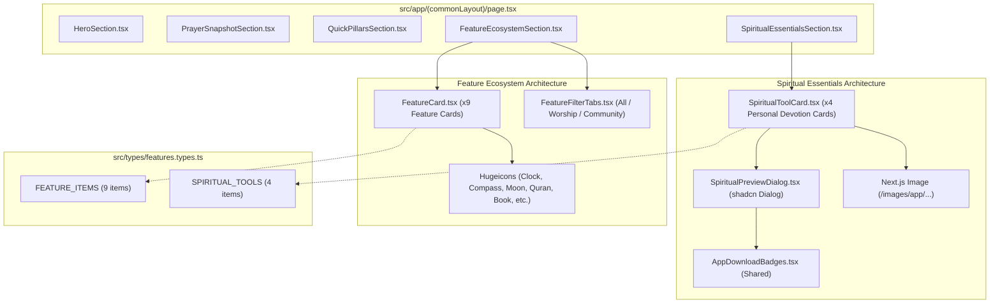

# Architectural Blueprint: Core Feature Ecosystem Grid & Spiritual Essentials Showcase (Phase 3)

## 1. Executive Architecture Overview

This blueprint translates [`REQ_feature_ecosystem_and_spiritual_tools.md`](file:///c:/Projects/an-noor-homepage/.agent/plans/REQ_feature_ecosystem_and_spiritual_tools.md) into a modular, production-ready frontend architecture adhering strictly to Next.js App Router standards and the An-Noor Frontend Architecture guidelines.



---

## 2. 3-Tier Reusability Strategy & Component Inventory

Adhering strictly to the **Mandatory 3-Tier Priority Strategy**:

### Tier 1: Existing Project Components & Universal DRY Reuse
| Existing Project Component / Path | Reusability Role in This Feature | Adaptations / Extensions |
| :--- | :--- | :--- |
| [`src/components/ui/badge.tsx`](file:///c:/Projects/an-noor-homepage/src/components/ui/badge.tsx) | Category pills, trust tags, and highlight chips. | Consumed directly with semantic variants. |
| [`src/components/ui/button.tsx`](file:///c:/Projects/an-noor-homepage/src/components/ui/button.tsx) | Filter tab triggers and screenshot preview modal trigger buttons. | Consumed directly with `outline` and `default` styles. |
| [`src/components/ui/dialog.tsx`](file:///c:/Projects/an-noor-homepage/src/components/ui/dialog.tsx) | Modal dialog for interactive screenshot viewing (`SpiritualPreviewDialog`). | Built on official shadcn dialog installed in Phase 2. |
| [`src/components/shared/AppDownloadBadges.tsx`](file:///c:/Projects/an-noor-homepage/src/components/shared/AppDownloadBadges.tsx) | Conversion trigger inside the screenshot preview dialog. | Embedded with `variant="compact"`. |
| [`src/components/shared/Logo.tsx`](file:///c:/Projects/an-noor-homepage/src/components/shared/Logo.tsx) | Brand mark watermark. | Embedded in showcase headers. |

### Tier 2: Official shadcn/ui Components
- `Button`, `Badge`, `Dialog` (already in `src/components/ui/`).

### Tier 3: Custom Tailwind CSS Components
| Custom Component | File Path | Architectural Justification |
| :--- | :--- | :--- |
| Filter Tabs Pill | `FeatureFilterTabs.tsx` | Specialized animated category switcher matching An-Noor emerald aesthetic. |
| Ecosystem Feature Card | `FeatureCard.tsx` | Specialized card with icon badge, anchor jump link, and soft emerald hover states. |
| Spiritual Tool Card | `SpiritualToolCard.tsx` | Specialized card with split layout embedding Next.js `Image` inside a phone frame container. |

---

## 3. TypeScript Contracts & Data Models (`src/types/features.types.ts`)

```typescript
export type FeatureCategory = "all" | "worship" | "community";

export interface FeatureItem {
  id: string;
  title: string;
  subtitle: string;
  description: string;
  category: "worship" | "community";
  iconName: "clock" | "compass" | "moon" | "quran" | "book" | "tasbih" | "mosque" | "restaurant" | "calendar";
  badgeText: string;
  href: string;
}

export interface SpiritualToolItem {
  id: string;
  title: string;
  arabicTitle: string;
  subtitle: string;
  description: string;
  highlights: string[];
  imageSrc: string;
  imageAlt: string;
  iconName: "compass" | "quran" | "book" | "tasbih";
  previewTitle: string;
  previewDetails: string[];
}
```

---

## 4. Curated Mobile Screenshot Assets Mapping

All images are verified in `public/images/app/`:
1. **Qibla Direction Compass**:
   - Source: `/images/app/qibla-mockup.png`
   - Aspect Ratio: $1380 \times 2920$ (vertical phone mockup)
   - Visual: Kaaba pointer, degree dial, magnetic declination indicator
2. **The Holy Quran & Audio Recitations**:
   - Source: `/images/app/feature-banner.png`
   - Aspect Ratio: $2048 \times 1000$ (horizontal landscape showcase)
   - Visual: Surah reading text, verse translations, audio recitation player
3. **Duas & Hisnul Muslim**:
   - Source: `/images/app/duas-mockup.png`
   - Aspect Ratio: $1380 \times 2920$ (vertical phone mockup)
   - Visual: Authentic supplications, Arabic calligraphy, English transliteration
4. **Digital Tasbih & Dhikr Counter**:
   - Source: `/images/app/tasbih-mockup.png`
   - Aspect Ratio: $1380 \times 2920$ (vertical phone mockup)
   - Visual: Circular dhikr bead ring, target counter, Amal history log

---

## 5. Component Decomposition & Hierarchy (Target < 300 Lines)

Each file has a single responsibility, strictly under 300 lines of code:

| Component File Path | Primary Responsibility | Reused Dependencies | Est. Lines |
| :--- | :--- | :--- | :---: |
| `src/types/features.types.ts` | Shared TypeScript contracts & curated data lists | None | ~140 |
| `src/components/homePage/FeatureFilterTabs.tsx` | Category tabs switcher ("all", "worship", "community") | `Button`, `Badge`, `cn` | ~90 |
| `src/components/homePage/FeatureCard.tsx` | 9-box ecosystem feature card with anchor link | `Badge`, Hugeicons, `Link` | ~110 |
| `src/components/homePage/FeatureEcosystemSection.tsx` | Section orchestrator & dynamic filter grid | `FeatureFilterTabs`, `FeatureCard` | ~130 |
| `src/components/homePage/SpiritualPreviewDialog.tsx` | Accessible screenshot zoom modal with download CTAs | `Dialog`, `Image`, `AppDownloadBadges` | ~130 |
| `src/components/homePage/SpiritualToolCard.tsx` | 4-pillar devotional card with embedded mobile phone frame | `Image`, `Badge`, Hugeicons, `SpiritualPreviewDialog` | ~160 |
| `src/components/homePage/SpiritualEssentialsSection.tsx` | Spiritual essentials section orchestrator | `SpiritualToolCard`, `Badge` | ~150 |
| `src/app/(commonLayout)/page.tsx` | Full homepage layout orchestrator | All sections assembled | ~35 |

---

## 6. Color Token Governance (Zero Hardcoded Colors)

All elements strictly map to centralized CSS variables in `src/app/globals.css`:
- **Brand Emerald (`--primary`)**: Used for active filter tab, icon containers, headline underline, and card hover accents.
- **Surface Muted Mint (`--muted`)**: Used for inactive filter tab background, phone chassis container, and tag chips.
- **Card Neutral (`--card`, `--card-foreground`)**: Used for card surfaces with soft slate shadows.
- **Subtle Borders (`--border`)**: Used for card outlines and modal dividers.

---

## 7. Pure TDD Unit Test Architecture Plan

Unit tests strictly isolated in `__tests__/homePage/`:
1. `__tests__/types/features.types.test.ts`:
   - Validates data constants: 9 features in `FEATURE_ITEMS` and 4 tools in `SPIRITUAL_TOOLS`.
   - Validates categories: 6 worship and 3 community items.
2. `__tests__/homePage/FeatureFilterTabs.test.tsx`:
   - Renders 3 filter tabs with correct count badges.
   - Triggers `onSelectCategory` when clicked.
3. `__tests__/homePage/FeatureCard.test.tsx`:
   - Renders title, subtitle, description, and Hugeicon.
   - Renders valid anchor jump link (`href="#..."`).
4. `__tests__/homePage/FeatureEcosystemSection.test.tsx`:
   - Renders section header, filter tabs, and feature cards grid.
   - Dynamically filters cards when category state changes.
5. `__tests__/homePage/SpiritualToolCard.test.tsx`:
   - Renders Arabic title, English title, description, and highlights chips.
   - Embeds Next.js `Image` with verified image source path.
6. `__tests__/homePage/SpiritualPreviewDialog.test.tsx`:
   - Opens accessible dialog upon trigger click.
   - Displays full-res image and download CTA button.
7. `__tests__/homePage/SpiritualEssentialsSection.test.tsx`:
   - Renders section header and 4 spiritual tool cards (Qibla, Quran, Duas, Tasbih).

