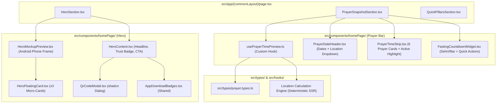

# Architectural Blueprint: Hero Section Centerpiece & Live Interactive Prayer Snapshot Bar

## 1. Executive Architecture Overview

This blueprint translates the requirements in [`REQ_hero_and_prayer_snapshot.md`](file:///c:/Projects/an-noor-homepage/.agent/plans/REQ_hero_and_prayer_snapshot.md) into a modular, production-ready frontend architecture adhering strictly to Next.js App Router standards and the An-Noor Frontend Architecture guidelines.



---

## 2. 3-Tier Reusability Strategy & Component Inventory

Adhering strictly to the **Mandatory 3-Tier Priority Strategy**:

### Tier 1: Existing Project Components & Universal DRY Reuse
| Existing Project Component / Path | Reusability Role in This Feature | Adaptations / Extensions |
| :--- | :--- | :--- |
| [`src/components/shared/Logo.tsx`](file:///c:/Projects/an-noor-homepage/src/components/shared/Logo.tsx) | Official brand mark rendered inside the mobile device mockup header. | Consumed directly with `variant="compact"` and `asLink={false}` to avoid nested links. |
| [`src/components/shared/AppDownloadBadges.tsx`](file:///c:/Projects/an-noor-homepage/src/components/shared/AppDownloadBadges.tsx) | Primary CTA conversion button group in `HeroContent`. | Reused directly with `variant="hero"` and `showDirectApk={true}`. |
| [`src/lib/constants.ts`](file:///c:/Projects/an-noor-homepage/src/lib/constants.ts) | Centralized brand metadata (`APP_CONFIG`). | Reused for `defaultLocation`, `tagline`, `subTagline`, and store URLs. |
| [`src/components/homePage/QuickPillarsSection.tsx`](file:///c:/Projects/an-noor-homepage/src/components/homePage/QuickPillarsSection.tsx) | 6 Core Pillars showcase section. | Integrated seamlessly immediately after `PrayerSnapshotSection` in `page.tsx`. |

### Tier 2: Official shadcn/ui Components
| shadcn Component | Source File | Role & Usage |
| :--- | :--- | :--- |
| `Button` | [`src/components/ui/button.tsx`](file:///c:/Projects/an-noor-homepage/src/components/ui/button.tsx) | CTA triggers, dropdown triggers, and modal action buttons. |
| `Badge` | [`src/components/ui/badge.tsx`](file:///c:/Projects/an-noor-homepage/src/components/ui/badge.tsx) | Trust tags ("100% Free"), prayer badges ("Next in 1h 48m"), event pills. |
| `DropdownMenu` | [`src/components/ui/dropdown-menu.tsx`](file:///c:/Projects/an-noor-homepage/src/components/ui/dropdown-menu.tsx) | Accessible location switcher in `PrayerDateHeader`. |
| `Dialog` | [`src/components/ui/dialog.tsx`](file:///c:/Projects/an-noor-homepage/src/components/ui/dialog.tsx) | Accessible desktop QR code scanner modal in `QrCodeModal`. |

### Tier 3: Custom Tailwind CSS Components
| Custom Component | File Path | Architectural Justification |
| :--- | :--- | :--- |
| Android Device Frame | `HeroMockupPreview.tsx` | Highly specialized native phone mockup styling (camera notch, subtle metallic bezel, screen reflection) tailored to An-Noor brand aesthetic. |
| Floating Micro-Cards | `HeroFloatingCard.tsx` | Specialized floating cards with ambient blur and subtle keyframe animation. |
| Prayer Time Strip Cards | `PrayerTimeStrip.tsx` | Dynamic prayer cards with conditional emerald border and glow for the active prayer. |

---

## 3. TypeScript Contracts & Data Models (`src/types/prayer.types.ts`)

```typescript
export type PrayerName = "fajr" | "sunrise" | "dhuhr" | "asr" | "maghrib" | "isha";

export interface PrayerTimeItem {
  id: PrayerName;
  label: string;
  arabicLabel: string;
  time: string;
  isNext: boolean;
  isPassed: boolean;
  iconName: "moon" | "sunrise" | "sun" | "sunset";
}

export interface LocationOption {
  id: string;
  city: string;
  region: string;
  label: string;
  country: string;
  timezone: string;
}

export interface DailyPrayerSnapshot {
  location: LocationOption;
  gregorianDate: string;
  hijriDate: string;
  prayers: PrayerTimeItem[];
  nextPrayer: PrayerTimeItem;
  timeRemainingText: string;
  sehriTime: string;
  iftarTime: string;
  fastingCountdownText: string;
  isFastingActive: boolean;
}

export interface FloatingCardData {
  id: string;
  badge: string;
  title: string;
  subtitle: string;
  category: "prayer" | "halal" | "event";
  highlightColor?: string;
}
```

---

## 4. Custom Hook Design: `src/hooks/usePrayerTimePreview.ts`

The hook encapsulates location selection, real-time calculation, date formatting, and countdown timers:

- **Deterministic SSR Baseline**:
  - Automatically initializes with the default location (`Irving, TX`) and pre-calculated baseline prayer times.
  - Returns `isMounted: false` during SSR to prevent hydration errors.
- **Client-Side Hydration & Live Timer**:
  - In `useEffect`, sets `isMounted: true` and starts a 1-second interval (`setInterval`) to update seconds remaining to the next prayer and Sehri/Iftar.
  - Automatically recalculates active prayer states when crossing prayer thresholds.
  - Implements clean interval teardown on unmount (`clearInterval`).
- **Supported Diaspora Locations**:
  - `irving`: Irving, TX (Baseline default)
  - `dallas`: Dallas, TX
  - `chicago`: Chicago, IL
  - `new-york`: New York, NY
  - `london`: London, UK
  - `toronto`: Toronto, Canada

---

## 5. Component Decomposition & Hierarchy (Target < 300 Lines)

Each file has a single responsibility, strictly under 300 lines of code:

| Component File Path | Primary Responsibility | Reused Dependencies | Est. Lines |
| :--- | :--- | :--- | :---: |
| `src/types/prayer.types.ts` | Shared TypeScript contracts | None | ~60 |
| `src/hooks/usePrayerTimePreview.ts` | State, timer, and calculation engine | `src/types/prayer.types.ts` | ~160 |
| `src/components/homePage/QrCodeModal.tsx` | Accessible desktop QR scanner modal | `Dialog`, `Button`, Hugeicons | ~110 |
| `src/components/homePage/HeroFloatingCard.tsx` | Floating micro-card with subtle hover | `Badge`, Hugeicons, `cn` | ~100 |
| `src/components/homePage/HeroMockupPreview.tsx` | Android phone frame & preview screen | `Logo`, `HeroFloatingCard`, Hugeicons | ~230 |
| `src/components/homePage/HeroContent.tsx` | Trust badge, headline, CTA buttons | `Badge`, `AppDownloadBadges`, `QrCodeModal` | ~130 |
| `src/components/homePage/HeroSection.tsx` | Hero section wrapper & 2-column grid | `HeroContent`, `HeroMockupPreview` | ~150 |
| `src/components/homePage/PrayerDateHeader.tsx` | Gregorian & Hijri date, location dropdown | `DropdownMenu`, `Button`, Hugeicons | ~130 |
| `src/components/homePage/PrayerTimeStrip.tsx` | 6 prayer cards with active indicator | `Badge`, Hugeicons, `cn` | ~180 |
| `src/components/homePage/FastingCountdownWidget.tsx` | Fasting timer cards & quick action CTAs | `Button`, Hugeicons, `cn` | ~140 |
| `src/components/homePage/PrayerSnapshotSection.tsx` | Prayer snapshot section orchestrator | `PrayerDateHeader`, `PrayerTimeStrip`, `FastingCountdownWidget` | ~160 |
| `src/app/(commonLayout)/page.tsx` | Landing page layout assembler | `HeroSection`, `PrayerSnapshotSection`, `QuickPillarsSection` | ~50 |

---

## 6. Color Token Governance (Zero Hardcoded Colors)

All elements strictly map to centralized CSS variables in `src/app/globals.css`:
- **Brand Emerald (`--primary`)**: Used for active prayer cards, store download buttons, QR modal accents, and logo.
- **Active Accent Green (`--accent`)**: Used for live pulse indicators, "Next Prayer" countdown pills, and active status tags.
- **Surface Muted Mint (`--muted`)**: Used for device phone frame backgrounds, inactive prayer cards, and subtle icon containers.
- **Slate Typographic Neutrals (`--foreground`, `--muted-foreground`)**: Used for high-contrast legible headings and descriptions.
- **Subtle Borders (`--border`)**: Used for card outlines and device bezel dividers.

---

## 7. Pure TDD Unit Test Architecture Plan

Unit tests strictly isolated in `__tests__/`:
1. `__tests__/hooks/usePrayerTimePreview.test.ts`:
   - Returns valid prayer snapshot for default location.
   - Accurately identifies upcoming prayer.
   - Changes location and updates timetable accordingly.
   - Cleans up timers without memory leaks.
2. `__tests__/homePage/HeroContent.test.tsx`:
   - Renders trust badge, headline, and sub-headline.
   - Renders download CTA buttons and QR modal trigger.
3. `__tests__/homePage/HeroMockupPreview.test.tsx`:
   - Renders CSS phone frame with camera notch.
   - Renders embedded brand logo and mobile UI preview.
   - Renders 3 floating contextual micro-cards.
4. `__tests__/homePage/HeroFloatingCard.test.tsx`:
   - Renders card badge, title, and subtitle.
   - Applies responsive layout and hover classes.
5. `__tests__/homePage/QrCodeModal.test.tsx`:
   - Opens dialog on trigger click.
   - Displays QR code graphic and scanning instructions.
6. `__tests__/homePage/PrayerDateHeader.test.tsx`:
   - Formats Gregorian and Hijri dates.
   - Renders dropdown with supported diaspora cities.
7. `__tests__/homePage/PrayerTimeStrip.test.tsx`:
   - Renders 6 prayer time cards (Fajr to Isha).
   - Dynamically highlights active upcoming prayer.
8. `__tests__/homePage/FastingCountdownWidget.test.tsx`:
   - Displays Sehri and Iftar times with countdown.
   - Renders Qibla and Mosque action buttons.
9. `__tests__/homePage/PrayerSnapshotSection.test.tsx`:
   - Orchestrates date header, prayer strip, and fasting countdown.
10. `__tests__/homePage/HeroSection.test.tsx`:
    - Renders responsive 2-column layout assembling `HeroContent` and `HeroMockupPreview`.
