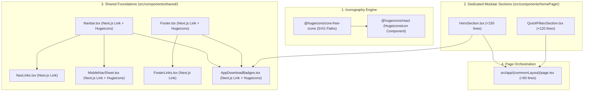

# System Architecture: Next.js Link Integration, Modular HomePage Sections & Hugeicons Migration

## 1. Architectural Blueprint & Component Flow



---

## 2. Component Decomposition & Responsibility Matrix

| File Path | Responsibility | Target Lines | Dependencies |
| :--- | :--- | :---: | :--- |
| `src/components/homePage/HeroSection.tsx` | Trust badge, headline, sub-headline, and download buttons | ~90 | `AppDownloadBadges`, `Badge`, `APP_CONFIG` |
| `src/components/homePage/QuickPillarsSection.tsx` | 6 quick pillar links (Prayer Times, Qibla, Halal, Mosque, Quran, Privacy) | ~90 | `Link`, `HugeiconsIcon`, `Clock01Icon`, `Compass01Icon`, `Restaurant01Icon`, `Mosque01Icon`, `Quran01Icon`, `ShieldCheckIcon` |
| `src/app/(commonLayout)/page.tsx` | Clean orchestrator rendering modular sections | ~40 | `HeroSection`, `QuickPillarsSection` |
| `src/components/shared/Navbar/Navbar.tsx` | Header bar with Next.js `Link` and Hugeicons | ~90 | `Link`, `HugeiconsIcon`, `Location01Icon`, `Download01Icon` |
| `src/components/shared/Navbar/NavLinks.tsx` | Desktop anchor links with Next.js `Link` | ~30 | `Link`, `NAV_ITEMS` |
| `src/components/shared/Navbar/MobileNavSheet.tsx` | Mobile drawer with Next.js `Link` and Hugeicons | ~95 | `Link`, `HugeiconsIcon`, `Menu01Icon`, `Location01Icon`, `SmartPhone01Icon` |
| `src/components/shared/Footer/Footer.tsx` | Footer with Next.js `Link` and Hugeicons | ~80 | `Link`, `HugeiconsIcon`, `ShieldCheckIcon`, `HeartIcon` |
| `src/components/shared/Footer/FooterLinks.tsx` | Footer link columns with Next.js `Link` | ~40 | `Link`, `FOOTER_CATEGORIES` |
| `src/components/shared/AppDownloadBadges.tsx` | Store buttons using Next.js `Link` and Hugeicons | ~75 | `Link`, `HugeiconsIcon`, `Download01Icon` |

---

## 3. Hugeicons Icon Specification

All icons will be rendered using the canonical Hugeicons pattern:
```tsx
import { HugeiconsIcon } from "@hugeicons/react";
import { Download01Icon } from "@hugeicons/core-free-icons";

<HugeiconsIcon icon={Download01Icon} size={16} strokeWidth={1.5} className="text-primary" />
```

| Location | Purpose | Hugeicons Component & Icon |
| :--- | :--- | :--- |
| `Navbar.tsx` | Location Indicator | `<HugeiconsIcon icon={Location01Icon} size={14} className="text-primary" />` |
| `Navbar.tsx` | CTA Download Button | `<HugeiconsIcon icon={Download01Icon} size={14} />` |
| `MobileNavSheet.tsx` | Menu Trigger | `<HugeiconsIcon icon={Menu01Icon} size={20} />` |
| `MobileNavSheet.tsx` | Location Indicator | `<HugeiconsIcon icon={Location01Icon} size={12} className="text-primary" />` |
| `MobileNavSheet.tsx` | Mobile CTA | `<HugeiconsIcon icon={SmartPhone01Icon} size={16} />` |
| `AppDownloadBadges.tsx` | Direct APK Icon | `<HugeiconsIcon icon={Download01Icon} size={16} className="text-primary" />` |
| `Footer.tsx` | Trust Badge | `<HugeiconsIcon icon={ShieldCheckIcon} size={16} className="text-primary" />` |
| `Footer.tsx` | Ummah Heart | `<HugeiconsIcon icon={HeartIcon} size={14} className="text-primary fill-primary" />` |
| `QuickPillarsSection.tsx` | Prayer Times | `<HugeiconsIcon icon={Clock01Icon} size={20} />` |
| `QuickPillarsSection.tsx` | Qibla Compass | `<HugeiconsIcon icon={Compass01Icon} size={20} />` |
| `QuickPillarsSection.tsx` | Nearby Halal | `<HugeiconsIcon icon={Restaurant01Icon} size={20} />` |
| `QuickPillarsSection.tsx` | Mosque Sync | `<HugeiconsIcon icon={Mosque01Icon} size={20} />` |
| `QuickPillarsSection.tsx` | Holy Quran | `<HugeiconsIcon icon={Quran01Icon} size={20} />` |
| `QuickPillarsSection.tsx` | Privacy First | `<HugeiconsIcon icon={ShieldCheckIcon} size={20} />` |

---

## 4. Unit Test Architecture Plan (`__tests__/`)

| Test File | Test Assertions |
| :--- | :--- |
| `__tests__/homePage/HeroSection.test.tsx` | - Renders headline, trust badge, and download CTA buttons.<br>- Does not contain hardcoded hex colors.<br>- Exports as a React component. |
| `__tests__/homePage/QuickPillarsSection.test.tsx` | - Renders 6 pillar links with Next.js `Link`.<br>- Includes correct SVG icons from Hugeicons (`Mosque01Icon`, `Quran01Icon`, etc.).<br>- Does not contain hardcoded hex colors. |
| `__tests__/components/Navbar.test.tsx` | - Confirms Next.js `Link` elements are rendered for brand and CTA.<br>- Confirms Hugeicons SVG elements render cleanly. |
| `__tests__/components/Footer.test.tsx` | - Confirms Next.js `Link` elements rendered for category links.<br>- Confirms `ShieldCheckIcon` and `HeartIcon` render. |
| `__tests__/components/AppDownloadBadges.test.ts` | - Confirms `Link` elements render with `target="_blank"`.<br>- Confirms `Download01Icon` renders. |

