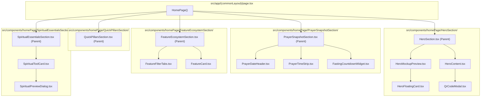

# Architectural Blueprint: Modular Section Folder Refactoring (An-Noor Homepage)

## 1. System Architecture Overview

This architectural blueprint establishes the structural refactoring of `src/components/homePage/` to encapsulate every homepage section within its own self-contained PascalCase directory. This mirrors the pattern in `src/components/shared/Navbar/` and `src/components/shared/Footer/`.



---

## 2. Directory Mapping & File Inventory

### 1. HeroSection Directory (`src/components/homePage/HeroSection/`)
| Source Path | Target Path | Responsibility | Estimated Lines |
| :--- | :--- | :--- | :---: |
| `src/components/homePage/HeroSection.tsx` | `src/components/homePage/HeroSection/HeroSection.tsx` | 2-column orchestrator assembling content and mockup | ~40 |
| `src/components/homePage/HeroContent.tsx` | `src/components/homePage/HeroSection/HeroContent.tsx` | Value headline, trust badge, app download badges, QR modal | ~65 |
| `src/components/homePage/HeroFloatingCard.tsx` | `src/components/homePage/HeroSection/HeroFloatingCard.tsx` | Contextual floating micro-cards | ~50 |
| `src/components/homePage/HeroMockupPreview.tsx` | `src/components/homePage/HeroSection/HeroMockupPreview.tsx` | Native CSS Android phone frame with app UI | ~170 |
| `src/components/homePage/QrCodeModal.tsx` | `src/components/homePage/HeroSection/QrCodeModal.tsx` | Accessible Base UI QR code desktop download modal | ~120 |

### 2. PrayerSnapshotSection Directory (`src/components/homePage/PrayerSnapshotSection/`)
| Source Path | Target Path | Responsibility | Estimated Lines |
| :--- | :--- | :--- | :---: |
| `src/components/homePage/PrayerSnapshotSection.tsx` | `src/components/homePage/PrayerSnapshotSection/PrayerSnapshotSection.tsx` | Prayer snapshot section orchestrator | ~55 |
| `src/components/homePage/PrayerDateHeader.tsx` | `src/components/homePage/PrayerSnapshotSection/PrayerDateHeader.tsx` | Gregorian/Hijri date header and location selector | ~110 |
| `src/components/homePage/PrayerTimeStrip.tsx` | `src/components/homePage/PrayerSnapshotSection/PrayerTimeStrip.tsx` | 6 prayer time cards with active highlight | ~115 |
| `src/components/homePage/FastingCountdownWidget.tsx` | `src/components/homePage/PrayerSnapshotSection/FastingCountdownWidget.tsx` | Fasting schedule timetable and quick action pills | ~100 |

### 3. QuickPillarsSection Directory (`src/components/homePage/QuickPillarsSection/`)
| Source Path | Target Path | Responsibility | Estimated Lines |
| :--- | :--- | :--- | :---: |
| `src/components/homePage/QuickPillarsSection.tsx` | `src/components/homePage/QuickPillarsSection/QuickPillarsSection.tsx` | 6-pillar rapid navigation anchor jump strip | ~55 |

### 4. FeatureEcosystemSection Directory (`src/components/homePage/FeatureEcosystemSection/`)
| Source Path | Target Path | Responsibility | Estimated Lines |
| :--- | :--- | :--- | :---: |
| `src/components/homePage/FeatureEcosystemSection.tsx` | `src/components/homePage/FeatureEcosystemSection/FeatureEcosystemSection.tsx` | 9-box ecosystem grid section orchestrator | ~75 |
| `src/components/homePage/FeatureFilterTabs.tsx` | `src/components/homePage/FeatureEcosystemSection/FeatureFilterTabs.tsx` | Category filter tabs with item count badges | ~65 |
| `src/components/homePage/FeatureCard.tsx` | `src/components/homePage/FeatureEcosystemSection/FeatureCard.tsx` | Reusable ecosystem feature card with anchor jump | ~85 |

### 5. SpiritualEssentialsSection Directory (`src/components/homePage/SpiritualEssentialsSection/`)
| Source Path | Target Path | Responsibility | Estimated Lines |
| :--- | :--- | :--- | :---: |
| `src/components/homePage/SpiritualEssentialsSection.tsx` | `src/components/homePage/SpiritualEssentialsSection/SpiritualEssentialsSection.tsx` | 4-pillar personal devotion showcase orchestrator | ~50 |
| `src/components/homePage/SpiritualToolCard.tsx` | `src/components/homePage/SpiritualEssentialsSection/SpiritualToolCard.tsx` | Devotional tool card with embedded phone mockup | ~95 |
| `src/components/homePage/SpiritualPreviewDialog.tsx` | `src/components/homePage/SpiritualEssentialsSection/SpiritualPreviewDialog.tsx` | Accessible Base UI modal dialog for zoom image preview | ~110 |

---

## 3. Import Resolution Strategy

1. **Section Parent Imports in `src/app/(commonLayout)/page.tsx`**:
   ```tsx
   import { HeroSection } from "@/components/homePage/HeroSection/HeroSection";
   import { PrayerSnapshotSection } from "@/components/homePage/PrayerSnapshotSection/PrayerSnapshotSection";
   import { QuickPillarsSection } from "@/components/homePage/QuickPillarsSection/QuickPillarsSection";
   import { FeatureEcosystemSection } from "@/components/homePage/FeatureEcosystemSection/FeatureEcosystemSection";
   import { SpiritualEssentialsSection } from "@/components/homePage/SpiritualEssentialsSection/SpiritualEssentialsSection";
   ```
2. **Child Components Inside Sibling Modules**:
   - Within `HeroSection/`: `import { HeroContent } from "./HeroContent";`
   - Within `PrayerSnapshotSection/`: `import { PrayerDateHeader } from "./PrayerDateHeader";`
   - Within `FeatureEcosystemSection/`: `import { FeatureCard } from "./FeatureCard";`
   - Within `SpiritualEssentialsSection/`: `import { SpiritualPreviewDialog } from "./SpiritualPreviewDialog";`
3. **External Dependencies**:
   - Shared components continue to resolve via `@/components/shared/`
   - UI components continue to resolve via `@/components/ui/`
   - Types resolve via `@/types/`
   - Constants resolve via `@/lib/constants`

---

## 4. Unit Test Suite Migration Plan

All 16 unit test files in `__tests__/homePage/` will be updated to import from the new component paths:
```tsx
// Example test import realignment:
import { HeroSection } from "../../src/components/homePage/HeroSection/HeroSection";
import { PrayerSnapshotSection } from "../../src/components/homePage/PrayerSnapshotSection/PrayerSnapshotSection";
import { FeatureEcosystemSection } from "../../src/components/homePage/FeatureEcosystemSection/FeatureEcosystemSection";
import { SpiritualEssentialsSection } from "../../src/components/homePage/SpiritualEssentialsSection/SpiritualEssentialsSection";
```
Target: 100% test pass rate (49/49 tests passing).

