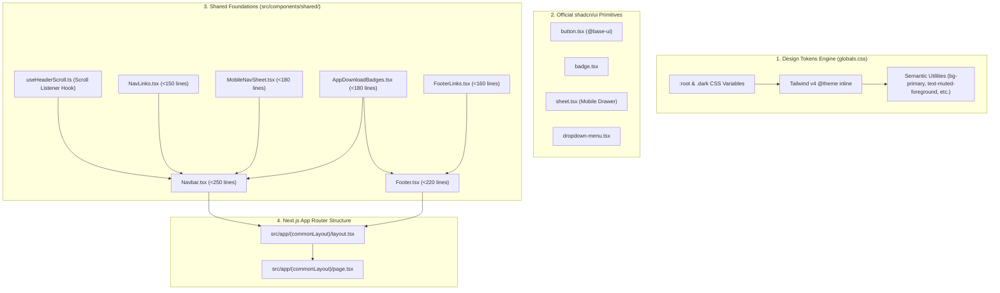

# System Architecture: Phase 1 — Design System, Color Tokens & Shared Layout Foundations

## 1. Architectural Overview & Context

This document establishes the technical blueprint for **Phase 1** of An-Noor Homepage, laying down the styling engine, design tokens, layout hierarchy, and reusable shared components.



---

## 2. Mandatory Reusable Components Inventory & 3-Tier Strategy

### 1st Priority: Project Shared Components
| Component / File Path | Role in Phase 1 | Implementation Notes |
| :--- | :--- | :--- |
| `src/hooks/useHeaderScroll.ts` | Reactive window scroll detection | Returns `{ isScrolled: boolean }` with passive event listener. |
| `src/lib/constants.ts` | Nav links, footer links, brand metadata | Single source of truth. |
| `src/components/shared/Navbar/Navbar.tsx` | Global sticky header | Consumes `useHeaderScroll`, hosts desktop links and mobile drawer. |
| `src/components/shared/Navbar/NavLinks.tsx` | Desktop nav items | Smooth hover effects with emerald underline transitions. |
| `src/components/shared/Navbar/MobileNavSheet.tsx` | Mobile drawer drawer | Slide-out drawer with navigation links and download buttons. |
| `src/components/shared/Footer/Footer.tsx` | Global persistent footer | Brand mission, categorized link columns, and copyright. |
| `src/components/shared/Footer/FooterLinks.tsx` | 3-column link groups | Features, Mosques, Legal links. |
| `src/components/shared/AppDownloadBadges.tsx` | Google Play & APK badges | High-fidelity buttons, accessible touch targets (>=44px). |

### 2nd Priority: Official shadcn/ui Components
| Component | Installation Command | Role |
| :--- | :--- | :--- |
| `Button` | Already present | Primary and outline action buttons. |
| `Badge` | `npx shadcn@latest add badge` | Location indicator pill and status badges. |
| `Sheet` | `npx shadcn@latest add sheet` | Accessible mobile navigation drawer. |
| `DropdownMenu` | `npx shadcn@latest add dropdown-menu` | Location switcher & options dropdown. |

### 3rd Priority: Custom Tailwind CSS Components
- **None required**. All layout and presentational containers will be composed strictly using semantic utility classes derived from official CSS variables.

---

## 3. Design Tokens & Color System Specification

In strict compliance with **Rule 15** (Zero Hardcoded Colors), all colors are defined as CSS variables inside `src/app/globals.css`:

```css
@theme inline {
  --color-primary: var(--primary);
  --color-primary-hover: var(--primary-hover);
  --color-primary-foreground: var(--primary-foreground);
  --color-accent: var(--accent);
  --color-accent-foreground: var(--accent-foreground);
  --color-muted: var(--muted);
  --color-muted-foreground: var(--muted-foreground);
  --color-background: var(--background);
  --color-foreground: var(--foreground);
  --color-card: var(--card);
  --color-card-foreground: var(--card-foreground);
  --color-border: var(--border);
  --color-ring: var(--ring);

  /* Brand Semantic Utilities */
  --color-brand-emerald: var(--brand-emerald);
  --color-brand-emerald-dark: var(--brand-emerald-dark);
  --color-brand-mint: var(--brand-mint);
  --color-brand-sage: var(--brand-sage);
}
```

### Color Token Mapping Table

| CSS Variable | Light Theme Value (OKLCH / Hex Equiv) | Dark Theme Value (OKLCH / Hex Equiv) | Semantic Purpose |
| :--- | :--- | :--- | :--- |
| `--primary` | `oklch(0.44 0.12 155)` (`#0D6847`) | `oklch(0.58 0.14 152)` (`#16A34A`) | Brand Primary Emerald |
| `--primary-hover` | `oklch(0.38 0.11 155)` (`#0A5237`) | `oklch(0.65 0.15 150)` (`#22C55E`) | Interactive Hover State |
| `--primary-foreground` | `oklch(1 0 0)` (`#FFFFFF`) | `oklch(0.12 0.04 155)` (`#051F14`) | High Contrast Text on Primary |
| `--accent` | `oklch(0.62 0.17 148)` (`#16A34A`) | `oklch(0.70 0.17 148)` (`#22C55E`) | Vibrant Accent / Active Status |
| `--accent-foreground` | `oklch(1 0 0)` (`#FFFFFF`) | `oklch(0.10 0.04 155)` | Text on Accent |
| `--muted` | `oklch(0.97 0.02 150)` (`#F0FDF4`) | `oklch(0.22 0.03 155)` (`#0F2E22`) | Soft Mint / Sage Surface |
| `--muted-foreground` | `oklch(0.48 0.03 240)` (`#475569`) | `oklch(0.72 0.02 240)` (`#94A3B8`) | Secondary / Slate Text |
| `--background` | `oklch(1 0 0)` (`#FFFFFF`) | `oklch(0.14 0.02 160)` (`#081C15`) | Page Background Canvas |
| `--foreground` | `oklch(0.18 0.03 240)` (`#0F172A`) | `oklch(0.96 0.01 160)` (`#F1F5F9`) | High-Contrast Slate Typography |
| `--card` | `oklch(0.99 0.01 150)` (`#F8FAFC`) | `oklch(0.18 0.03 160)` (`#0E2920`) | Card Surfaces |
| `--card-foreground` | `oklch(0.18 0.03 240)` (`#0F172A`) | `oklch(0.96 0.01 160)` (`#F1F5F9`) | Typography on Cards |
| `--border` | `oklch(0.92 0.02 150)` (`#E2E8F0`) | `oklch(0.28 0.04 155)` (`#1B4332`) | Dividers & Component Outlines |
| `--ring` | `oklch(0.55 0.14 152)` | `oklch(0.65 0.15 150)` | Focus Ring Color |
| `--brand-emerald` | `oklch(0.44 0.12 155)` | `oklch(0.58 0.14 152)` | Brand Emerald Utility |
| `--brand-mint` | `oklch(0.96 0.03 150)` | `oklch(0.25 0.04 155)` | Soft Mint Highlight |

---

## 4. Component Hierarchy & Decomposition Table

Every file strictly respects the target limit of **< 300 lines of code** (hard ceiling 400 lines) and the **One File, One Component** rule:

| File Path | Responsibility | Estimated Lines | Dependencies |
| :--- | :--- | :---: | :--- |
| `src/hooks/useHeaderScroll.ts` | Reactive window scroll detection hook | ~45 | React `useState`, `useEffect` |
| `src/lib/constants.ts` | Nav links, footer categories, brand metadata | ~80 | None |
| `src/components/shared/AppDownloadBadges.tsx` | Google Play & direct download badge buttons | ~120 | `Button`, `lucide-react` |
| `src/components/shared/Navbar/NavLinks.tsx` | Desktop navigation anchor link items | ~90 | `constants.ts`, `cn` |
| `src/components/shared/Navbar/MobileNavSheet.tsx` | Mobile slide-out drawer with links & CTAs | ~130 | `Sheet`, `Button`, `Badge` |
| `src/components/shared/Navbar/Navbar.tsx` | Sticky global header container | ~160 | `useHeaderScroll`, `NavLinks`, `MobileNavSheet` |
| `src/components/shared/Footer/FooterLinks.tsx` | 3-column categorized footer navigation | ~110 | `constants.ts` |
| `src/components/shared/Footer/Footer.tsx` | Global footer container with brand & legal | ~150 | `FooterLinks`, `AppDownloadBadges` |
| `src/app/(commonLayout)/layout.tsx` | Shared route group layout wrapper | ~50 | `Navbar`, `Footer` |
| `src/app/(commonLayout)/page.tsx` | Root landing page assembly | ~70 | Placeholder section anchors |

---

## 5. Unit Test Plan (`__tests__/`)

All tests reside exclusively inside `__tests__/` (never co-located in `src/`):

| Test Suite File | Unit Test Assertions & Edge Cases |
| :--- | :--- |
| `__tests__/hooks/useHeaderScroll.test.ts` | - Returns `isScrolled: false` when `scrollY <= 10`<br>- Returns `isScrolled: true` when `scrollY > 10`<br>- Cleans up window scroll event listener on unmount<br>- SSR safety (does not crash when `window` is undefined) |
| `__tests__/components/Navbar.test.tsx` | - Renders brand mark, desktop nav links, location pill, and CTA button<br>- Applies backdrop blur and border when `isScrolled` is true<br>- Toggles mobile menu button on viewports |
| `__tests__/components/MobileNavSheet.test.tsx` | - Renders navigation links in mobile drawer<br>- Includes location badge and download CTA<br>- Closes on link interaction |
| `__tests__/components/Footer.test.tsx` | - Renders brand mission statement, 3 categorized link groups, and copyright notice<br>- Links have valid href anchors |
| `__tests__/components/AppDownloadBadges.test.tsx` | - Renders Google Play store button with accessible touch target (>=44px)<br>- Handles size variants correctly (`sm`, `md`, `lg`) |

---

## 6. Autonomous Progression Note
In accordance with your directive ("proceed with phases till 5"), this architecture immediately transitions to **Phase 3: Task Generation**, followed by **Phase 4: TDD Implementation** and **Phase 5: Review & Merge**.

