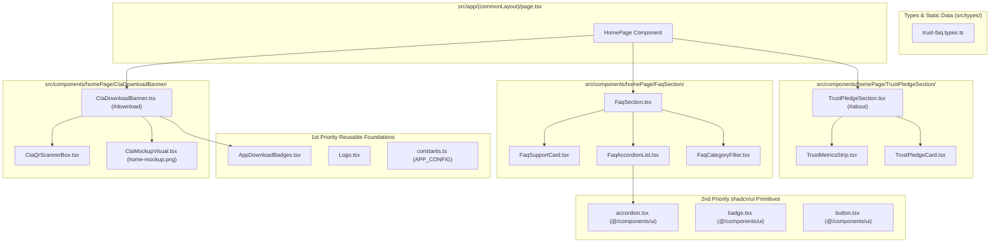

# Phase 2: System Architecture (ARCH) — Trust Pledge, FAQ Accordion & CTA Banner

**Feature Scope**: Phase 5 — Trust, Ethics & Privacy Pledge, FAQ Accordion, and App Store CTA Banner  
**Architecture Model**: Next.js 16 App Router, Pure Modular Component Hierarchy, Pure TDD  
**Document ID**: `ARCH_phase5_trust_faq_cta.md`  
**Status**: APPROVED & PROCEEDING TO TASK GENERATION

---

## 1. System Architecture Overview



---

## 2. Reusable Components Inventory & 3-Tier Priority Strategy

### 1st Priority: Project Reusable Components
| Existing Component | Source Path | Reusability Role in Phase 5 |
| :--- | :--- | :--- |
| `AppDownloadBadges` | `src/components/shared/AppDownloadBadges.tsx` | Provides official Google Play and Direct APK install buttons in `CtaDownloadBanner`. Supports `variant="hero"` and `showDirectApk`. |
| `Logo` | `src/components/shared/Logo.tsx` | Provides brand crest and wordmark with `variant="compact"` or default inside trust headers and CTA banner. |
| `APP_CONFIG` | `src/lib/constants.ts` | Source of truth for Play Store URL, APK download link, support email, and copyright year. |

### 2nd Priority: Official shadcn/ui Components
| Component | Source Path | Role in Phase 5 |
| :--- | :--- | :--- |
| `Badge` | `src/components/ui/badge.tsx` | Category indicators, trust metrics labels, and eyebrow pills. |
| `Button` | `src/components/ui/button.tsx` | Interactive category filters and external support links. |
| `Accordion` | `src/components/ui/accordion.tsx` | Accessible, animated expandable Q&A list. Installed via `npx shadcn@latest add accordion`. |

### 3rd Priority: Custom Tailwind CSS Components
| Component | Rationale & Justification |
| :--- | :--- |
| `CtaMockupVisual` | Custom smartphone perspective frame tailored to highlight `/images/app/home-mockup.png` with subtle floating badges. |
| `CtaQrScannerBox` | High-contrast QR code target widget with scanner guide for instant desktop-to-phone conversion. |

---

## 3. TypeScript Contracts & Static Data Architecture (`src/types/trust-faq.types.ts`)

```typescript
export interface TrustPillarItem {
  readonly id: string;
  readonly title: string;
  readonly description: string;
  readonly iconName: "shield" | "lock" | "verified" | "sparkles";
  readonly badgeText: string;
}

export interface TrustMetric {
  readonly label: string;
  readonly value: string;
  readonly description: string;
}

export type FaqCategory = "all" | "general" | "prayer" | "community" | "privacy";

export interface FaqItem {
  readonly id: string;
  readonly category: FaqCategory;
  readonly question: string;
  readonly answer: string;
  readonly highlights?: readonly string[];
}

export interface CtaFeaturePoint {
  readonly title: string;
  readonly subtitle: string;
}
```

---

## 4. Component Decomposition Table (Strict Line Limits <300 Lines)

| File Path | Responsibility | Estimated Lines | Dependencies |
| :--- | :--- | :---: | :--- |
| `src/types/trust-faq.types.ts` | Data models and curated static data | ~160 | None |
| `src/components/homePage/TrustPledgeSection/TrustPledgeCard.tsx` | Individual trust pillar card presentation | ~75 | `@hugeicons/react`, `Badge` |
| `src/components/homePage/TrustPledgeSection/TrustMetricsStrip.tsx` | 4-point quick guarantee badge row | ~70 | `Badge`, `@hugeicons/react` |
| `src/components/homePage/TrustPledgeSection/TrustPledgeSection.tsx` | Orchestrates cards, metrics, and `#about` anchor | ~110 | `TrustPledgeCard`, `TrustMetricsStrip` |
| `src/components/homePage/FaqSection/FaqCategoryFilter.tsx` | Interactive category filter pill strip | ~65 | `Button`, `Badge` |
| `src/components/homePage/FaqSection/FaqAccordionList.tsx` | Accordion rendering questions & answers | ~95 | `Accordion`, `AccordionItem`, etc. |
| `src/components/homePage/FaqSection/FaqSupportCard.tsx` | Bottom help and partner inquiry banner | ~70 | `Button`, Hugeicons |
| `src/components/homePage/FaqSection/FaqSection.tsx` | Orchestrates filters, accordion, and support card | ~120 | `FaqCategoryFilter`, `FaqAccordionList`, `FaqSupportCard` |
| `src/components/homePage/CtaDownloadBanner/CtaQrScannerBox.tsx` | QR code display box for mobile camera scanning | ~95 | Hugeicons, `APP_CONFIG` |
| `src/components/homePage/CtaDownloadBanner/CtaMockupVisual.tsx` | Smartphone frame with `/images/app/home-mockup.png` | ~90 | `next/image`, Hugeicons |
| `src/components/homePage/CtaDownloadBanner/CtaDownloadBanner.tsx` | Full-width emerald gradient CTA orchestrator (`#download`) | ~130 | `AppDownloadBadges`, `CtaQrScannerBox`, `CtaMockupVisual` |
| `src/app/(commonLayout)/page.tsx` | Mounts all 3 new sections in sequential order | ~65 | Home page sections |

---

## 5. Design Tokens & Color Governance (`src/app/globals.css`)

All components strictly use existing semantic tokens:
* **Backgrounds**: `bg-background`, `bg-card`, `bg-muted`, `bg-primary`, `bg-brand-emerald`, `bg-brand-emerald-dark`
* **Text**: `text-foreground`, `text-muted-foreground`, `text-primary`, `text-primary-foreground`
* **Borders**: `border-border`, `border-primary/20`, `border-border/60`
* **Accents**: `text-accent`, `bg-accent/10`
* **Zero inline `#...` or arbitrary Tailwind `[#...]` classes guarantee.**

---

## 6. Unit Testing Architecture Plan

Unit test files placed strictly in `__tests__/homePage/` and `__tests__/types/`:
1. `__tests__/types/trust-faq.types.test.ts`: Verifies data contracts, item counts, and non-empty questions/answers.
2. `__tests__/homePage/TrustPledgeCard.test.tsx`: Verifies card rendering, icon, title, and badge.
3. `__tests__/homePage/TrustMetricsStrip.test.tsx`: Verifies 4 metric items rendered with labels and values.
4. `__tests__/homePage/TrustPledgeSection.test.tsx`: Verifies section anchor `#about`, header, cards, and metrics strip.
5. `__tests__/homePage/FaqCategoryFilter.test.tsx`: Verifies category buttons and active category state.
6. `__tests__/homePage/FaqAccordionList.test.tsx`: Verifies accordion rendering and question text.
7. `__tests__/homePage/FaqSupportCard.test.tsx`: Verifies contact support email link and copy.
8. `__tests__/homePage/FaqSection.test.tsx`: Verifies filter interaction, accordion list, and support card.
9. `__tests__/homePage/CtaQrScannerBox.test.tsx`: Verifies QR code SVG rendering and scan guide copy.
10. `__tests__/homePage/CtaMockupVisual.test.tsx`: Verifies Image rendering of `/images/app/home-mockup.png` and mockup frame.
11. `__tests__/homePage/CtaDownloadBanner.test.tsx`: Verifies section anchor `#download`, download badges, headline, and responsive grid.
12. `__tests__/homePage/HomePageAssembly.test.tsx`: Updated integration test verifying all 11 homepage sections render cleanly without placeholders.

