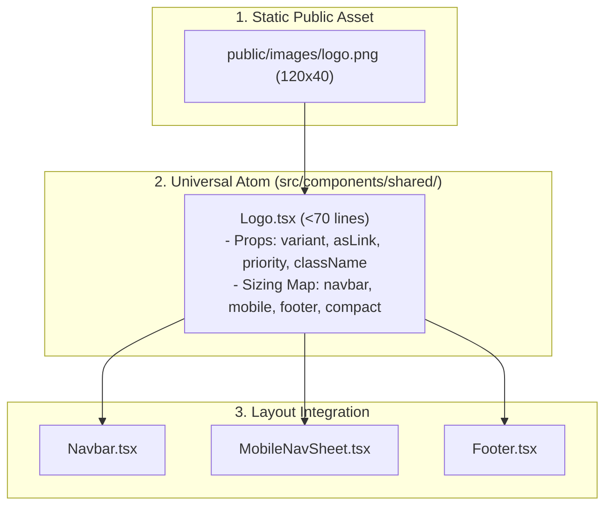

# System Architecture: Reusable Universal Brand Logo Component (`Logo.tsx`)

## 1. Architectural Blueprint & Component Flow



---

## 2. Component Contract & Sizing Map

```tsx
export type LogoVariant = "navbar" | "mobile" | "footer" | "compact";

export interface LogoProps {
  className?: string;
  variant?: LogoVariant;
  asLink?: boolean;
  priority?: boolean;
}

const VARIANT_CONFIG: Record<
  LogoVariant,
  { width: number; height: number; imgClass: string }
> = {
  navbar: { width: 108, height: 36, imgClass: "h-9 w-auto object-contain" },
  mobile: { width: 96, height: 32, imgClass: "h-8 w-auto object-contain" },
  footer: { width: 120, height: 40, imgClass: "h-10 w-auto object-contain" },
  compact: { width: 84, height: 28, imgClass: "h-7 w-auto object-contain" },
};
```

---

## 3. Component Responsibility Matrix

| File Path | Responsibility | Target Lines | Dependencies |
| :--- | :--- | :---: | :--- |
| `src/components/shared/Logo.tsx` | Universal Logo component with variant sizing and link options | ~60 | `next/image`, `next/link`, `cn` |
| `src/components/shared/Navbar/Navbar.tsx` | Consumes `<Logo variant="navbar" priority />` | ~90 | `Logo` |
| `src/components/shared/Navbar/MobileNavSheet.tsx` | Consumes `<Logo variant="mobile" asLink={false} />` in `SheetTitle` | ~100 | `Logo` |
| `src/components/shared/Footer/Footer.tsx` | Consumes `<Logo variant="footer" />` | ~75 | `Logo` |

---

## 4. Unit Test Plan (`__tests__/`)

| Test File | Test Assertions |
| :--- | :--- |
| `__tests__/components/Logo.test.tsx` | - Renders `<Link href="/">` by default with `alt="AnNoor Logo"`.<br>- Renders non-interactive `<Image>` when `asLink={false}`.<br>- Applies appropriate width/height for `"navbar"`, `"mobile"`, and `"footer"` variants.<br>- Preloads image when `priority={true}`.<br>- Does not contain hardcoded hex colors. |
| `__tests__/components/Navbar.test.tsx` | Confirms Navbar renders Logo component. |
| `__tests__/components/Footer.test.tsx` | Confirms Footer renders Logo component. |
| `__tests__/components/MobileNavSheet.test.tsx` | Confirms MobileNavSheet renders Logo component without anchor inside SheetTitle. |

