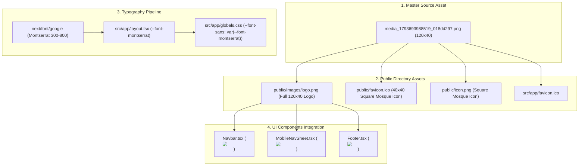

# System Architecture: Montserrat Typography, Official Brand Logo & Favicon Integration

## 1. Architectural Blueprint & Asset Flow

---

## 2. Component Responsibility Matrix

| File Path | Responsibility | Target Lines | Dependencies |
| :--- | :--- | :---: | :--- |
| `src/app/layout.tsx` | Montserrat font initialization, HTML class, and metadata icons | ~35 | `next/font/google` Montserrat |
| `src/app/globals.css` | Maps `--font-sans` to `var(--font-montserrat)` in `@theme inline` | ~135 | Tailwind CSS v4 |
| `src/components/shared/Navbar/Navbar.tsx` | Replaces text mark with official `<Image src="/images/logo.png" />` | ~90 | `next/image`, `next/link` |
| `src/components/shared/Navbar/MobileNavSheet.tsx` | Replaces sheet brand placeholder with official logo | ~105 | `next/image`, `next/link` |
| `src/components/shared/Footer/Footer.tsx` | Replaces footer brand placeholder with official logo | ~80 | `next/image`, `next/link` |

---

## 3. Asset Specifications

- **Logo Dimensions**: Original 120×40 pixels.
- **Navbar Display Size**: Rendered with `width={108} height={36}` with `priority` attribute to eliminate LCP delay.
- **Mobile Sheet Display Size**: Rendered with `width={96} height={32}`.
- **Footer Display Size**: Rendered with `width={120} height={40}`.
- **Favicon**: 40×40 pixel crop of the left mosque emblem on the rounded green canvas, saved as both `.png` and `.ico`.

---

## 4. Unit Test Architecture Plan (`__tests__/`)

| Test Suite File | Test Assertions |
| :--- | :--- |
| `__tests__/components/Navbar.test.tsx` | - Confirms `Navbar` renders `next/image` with `src="/images/logo.png"` and `alt="AnNoor Logo"`. - Confirms no hardcoded hex colors exist. |
| `__tests__/components/Footer.test.tsx` | - Confirms `Footer` renders `next/image` with `src="/images/logo.png"`. - Confirms copyright and mission statement integrity. |
| `__tests__/components/MobileNavSheet.test.tsx` | - Confirms `MobileNavSheet` renders official logo in `SheetTitle`. |

