# Phase 3: Task Generation (TASKS) — Trust Pledge, FAQ Accordion & CTA Banner

**Feature Scope**: Phase 5 — Trust, Ethics & Privacy Pledge, FAQ Accordion, and App Store CTA Banner  
**Workflow Model**: Pure Test-Driven Development (TDD: Red -> Green -> Refactor)  
**Document ID**: `TASKS_phase5_trust_faq_cta.md`  
**Status**: APPROVED & READY FOR TDD IMPLEMENTATION

---

## 1. Execution Tracks Overview

```mermaid
flowchart TD
    subgraph TrackB["Track B: Contracts & Data"]
        T0["Task 0: Install shadcn Accordion"]
        T1["Task 1: Types & Curated Data (trust-faq.types.ts)"]
    end

    subgraph TrackA["Track A: UI Presentation Atoms"]
        T2["Task 2: TrustPledgeCard & TrustMetricsStrip"]
        T3["Task 3: FaqCategoryFilter & FaqAccordionList & FaqSupportCard"]
        T4["Task 4: CtaQrScannerBox & CtaMockupVisual"]
    end

    subgraph TrackC["Track C: Section & Page Orchestration"]
        T5["Task 5: TrustPledgeSection (#about)"]
        T6["Task 6: FaqSection (Interactive Filtering & Accordion)"]
        T7["Task 7: CtaDownloadBanner (#download)"]
        T8["Task 8: Page Assembly & Global Integration (page.tsx)"]
    end

    T0 --> T1
    T1 --> T2 & T3 & T4
    T2 --> T5
    T3 --> T6
    T4 --> T7
    T5 & T6 & T7 --> T8
```

---

## 2. Atomic Micro-Tasks

### Task 0: Install Official shadcn/ui Accordion Component
- **Requirement Trace**: FR-2, NFR-5
- **Execution Track**: Track B (Prerequisites)
- **Can Run in Parallel With**: None
- **Files to Create / Modify**:
  - Source: `src/components/ui/accordion.tsx` (via `npx shadcn@latest add accordion`)
- **Estimated Line Count**: ~70 lines
- **Dependencies**: None
- **Unit Test Plan (TDD Red-First)**: Validated when imported in `FaqAccordionList.test.tsx`.
- **Acceptance Criteria**: Official shadcn accordion primitive exists with `Accordion`, `AccordionItem`, `AccordionTrigger`, and `AccordionContent`.

---

### Task 1: TypeScript Contracts & Curated Data (`trust-faq.types.ts`)
- **Requirement Trace**: FR-1, FR-2, FR-3
- **Execution Track**: Track B (Contracts & Data)
- **Can Run in Parallel With**: None (Prerequisite for UI Atoms)
- **Files to Create / Modify**:
  - Source: `src/types/trust-faq.types.ts`
  - Unit Test: `__tests__/types/trust-faq.types.test.ts`
- **Estimated Line Count**: ~160 lines
- **Dependencies**: Task 0
- **Unit Test Plan (TDD Red-First)**:
  - Verify `TRUST_PILLARS` exports 3 comprehensive pillars with non-empty titles and descriptions.
  - Verify `TRUST_METRICS` exports 4 guarantee items.
  - Verify `FAQ_CATEGORIES` exports 5 category definitions.
  - Verify `FAQ_ITEMS` exports 6 verified questions with non-empty answers covering all categories.
- **Acceptance Criteria**: 100% green unit test; TypeScript compilation with zero `any`.

---

### Task 2: Trust Presentation Atoms (`TrustPledgeCard` & `TrustMetricsStrip`)
- **Requirement Trace**: FR-1, NFR-2, NFR-3
- **Execution Track**: Track A (UI Atoms)
- **Can Run in Parallel With**: Task 3, Task 4
- **Files to Create / Modify**:
  - Source:
    - `src/components/homePage/TrustPledgeSection/TrustPledgeCard.tsx`
    - `src/components/homePage/TrustPledgeSection/TrustMetricsStrip.tsx`
  - Unit Tests:
    - `__tests__/homePage/TrustPledgeCard.test.tsx`
    - `__tests__/homePage/TrustMetricsStrip.test.tsx`
- **Estimated Line Count**: ~80 lines each
- **Dependencies**: Task 1
- **Unit Test Plan (TDD Red-First)**:
  - `TrustPledgeCard.test.tsx`: Renders title, badge, description, and corresponding Hugeicons glyph.
  - `TrustMetricsStrip.test.tsx`: Renders all 4 metric items with correct values and labels.
- **Acceptance Criteria**: Passes isolated tests; enforces <300 lines per file; zero hardcoded colors.

---

### Task 3: FAQ Presentation Atoms (`FaqCategoryFilter`, `FaqAccordionList`, `FaqSupportCard`)
- **Requirement Trace**: FR-2, NFR-5, NFR-7
- **Execution Track**: Track A (UI Atoms)
- **Can Run in Parallel With**: Task 2, Task 4
- **Files to Create / Modify**:
  - Source:
    - `src/components/homePage/FaqSection/FaqCategoryFilter.tsx`
    - `src/components/homePage/FaqSection/FaqAccordionList.tsx`
    - `src/components/homePage/FaqSection/FaqSupportCard.tsx`
  - Unit Tests:
    - `__tests__/homePage/FaqCategoryFilter.test.tsx`
    - `__tests__/homePage/FaqAccordionList.test.tsx`
    - `__tests__/homePage/FaqSupportCard.test.tsx`
- **Estimated Line Count**: ~70 lines, ~95 lines, ~70 lines
- **Dependencies**: Task 0, Task 1
- **Unit Test Plan (TDD Red-First)**:
  - `FaqCategoryFilter.test.tsx`: Renders all category pills; marks active category with primary styles.
  - `FaqAccordionList.test.tsx`: Renders FAQ questions and answers via shadcn Accordion.
  - `FaqSupportCard.test.tsx`: Renders support email link and partner mosque prompt.
- **Acceptance Criteria**: Clean interactive filtering; accessible ARIA accordion bindings.

---

### Task 4: CTA Presentation Atoms (`CtaQrScannerBox` & `CtaMockupVisual`)
- **Requirement Trace**: FR-3, NFR-2, NFR-8
- **Execution Track**: Track A (UI Atoms)
- **Can Run in Parallel With**: Task 2, Task 3
- **Files to Create / Modify**:
  - Source:
    - `src/components/homePage/CtaDownloadBanner/CtaQrScannerBox.tsx`
    - `src/components/homePage/CtaDownloadBanner/CtaMockupVisual.tsx`
  - Unit Tests:
    - `__tests__/homePage/CtaQrScannerBox.test.tsx`
    - `__tests__/homePage/CtaMockupVisual.test.tsx`
- **Estimated Line Count**: ~90 lines each
- **Dependencies**: Task 1
- **Unit Test Plan (TDD Red-First)**:
  - `CtaQrScannerBox.test.tsx`: Renders styled SVG QR code with camera scanning instructions.
  - `CtaMockupVisual.test.tsx`: Renders Next.js `Image` pointing to `/images/app/home-mockup.png` inside an angled smartphone frame.
- **Acceptance Criteria**: High aesthetic polish, touch-friendly, zero overflow.

---

### Task 5: Trust Pledge Section Orchestration (`TrustPledgeSection`)
- **Requirement Trace**: FR-1, NFR-1
- **Execution Track**: Track C (Section Integration)
- **Can Run in Parallel With**: Task 6, Task 7
- **Files to Create / Modify**:
  - Source: `src/components/homePage/TrustPledgeSection/TrustPledgeSection.tsx`
  - Unit Test: `__tests__/homePage/TrustPledgeSection.test.tsx`
- **Estimated Line Count**: ~110 lines
- **Dependencies**: Task 2
- **Unit Test Plan (TDD Red-First)**:
  - Verifies section contains `id="about"` anchor.
  - Verifies header eyebrow, headline, 3-card grid, and metrics guarantee strip.
- **Acceptance Criteria**: Passes unit tests; smooth anchor scroll navigation.

---

### Task 6: FAQ Section Orchestration (`FaqSection`)
- **Requirement Trace**: FR-2, NFR-1
- **Execution Track**: Track C (Section Integration)
- **Can Run in Parallel With**: Task 5, Task 7
- **Files to Create / Modify**:
  - Source: `src/components/homePage/FaqSection/FaqSection.tsx`
  - Unit Test: `__tests__/homePage/FaqSection.test.tsx`
- **Estimated Line Count**: ~120 lines
- **Dependencies**: Task 3
- **Unit Test Plan (TDD Red-First)**:
  - Verifies section header, category filter interaction, accordion item expansion, and fallback when filtered.
- **Acceptance Criteria**: Client-side category filtering works with zero re-render flicker.

---

### Task 7: CTA Download Banner Orchestration (`CtaDownloadBanner`)
- **Requirement Trace**: FR-3, NFR-1
- **Execution Track**: Track C (Section Integration)
- **Can Run in Parallel With**: Task 5, Task 6
- **Files to Create / Modify**:
  - Source: `src/components/homePage/CtaDownloadBanner/CtaDownloadBanner.tsx`
  - Unit Test: `__tests__/homePage/CtaDownloadBanner.test.tsx`
- **Estimated Line Count**: ~130 lines
- **Dependencies**: Task 4
- **Unit Test Plan (TDD Red-First)**:
  - Verifies section contains `id="download"` anchor.
  - Verifies presence of `AppDownloadBadges` (Google Play + Direct APK), `CtaQrScannerBox`, and `CtaMockupVisual`.
- **Acceptance Criteria**: High contrast in Light/Dark mode; zero horizontal overflow.

---

### Task 8: Home Page Assembly & Global Integration (`page.tsx`)
- **Requirement Trace**: FR-4
- **Execution Track**: Track C (Page Assembly)
- **Can Run in Parallel With**: None
- **Files to Create / Modify**:
  - Source: `src/app/(commonLayout)/page.tsx`
  - Unit Test: `__tests__/homePage/HomePageAssembly.test.tsx`
- **Estimated Line Count**: ~55 lines
- **Dependencies**: Task 5, Task 6, Task 7
- **Unit Test Plan (TDD Red-First)**:
  - Verifies all 11 homepage sections render sequentially without placeholder elements.
  - Confirms anchors `#prayer-times`, `#features`, `#spiritual-tools`, `#community`, `#halal-finder`, `#events`, `#about`, and `#download` exist and match navbar/footer targets.
- **Acceptance Criteria**: Full suite green; `npx tsc --noEmit` and `npm run build` pass cleanly.

