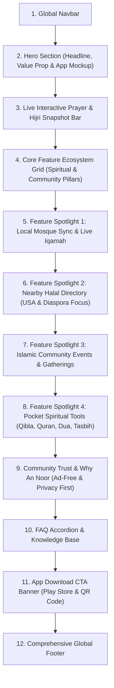

# An Noor Homepage — Senior Architectural Plan & Design Blueprint

## 1. Executive Summary & Vision

**An Noor** ("The Light") is a modern, privacy-focused Islamic Android application crafted to serve the daily spiritual and practical lifestyle needs of Muslims, with special emphasis on Muslims living in diaspora / Western societies (e.g., North America, Europe) where local community discovery, verified Halal availability, and authentic Mosque sync are vital.

The mobile application and its administrative backend dashboard are already developed. Our goal is to architect and design the official web landing page for **An Noor** that:
1. **Communicates Value Instantly**: Highlights the unique fusion of spiritual essentials (Prayer, Qibla, Quran, Duas, Tasbih) and localized community lifestyle features (Nearby Halal, Mosque integration, Islamic events).
2. **Drives Mobile App Adoption**: Serves as the primary conversion funnel to download the Android app from Google Play (and future iOS release).
3. **Reflects Brand Identity**: Faithfully honors the color palette, typography, clean card layout, and modern Islamic aesthetic seen in the An Noor mobile app screenshot, while drawing structural and navigational UX inspiration from modern Islamic landing pages such as Tazkirah (`tazkirah.app`).
4. **Adheres Strictly to Project Architecture**: Follows Next.js App Router guidelines, modular feature folders (`src/components/modules/Home/`), pure Tailwind CSS with shadcn/ui components, strict file size budgets (< 300 lines per file), and complete device responsiveness.

---

## 2. Comparative Analysis: An Noor App vs. Tazkirah Reference

| Dimension | An Noor Mobile App (Our Core Product) | Tazkirah Reference (`tazkirah.app/bn/`) | An Noor Homepage Strategy |
| :--- | :--- | :--- | :--- |
| **Primary Palette** | Rich Emerald / Forest Green (`#0D6847`), Mint Tint (`#E8F5E9`), Crisp White cards, Dark Slate text (`#0F172A`). | Deep Green / Kelly Green with high-contrast lime touches. | Retain An Noor’s dignified Emerald Green branding (`#0D6847` / `#16A34A`), subtle emerald gradients, and soft slate shadows. |
| **Language & Audience** | English UI tailored for global Muslims (e.g., Irving, TX, USA location shown). | Bengali (`bn`), targeted for Bangladesh. | Primary English language, internationalized layout structure ready for multilingual support. |
| **Core Differentiator** | **Localized Community & Lifestyle**: Nearby Halal dining & groceries, Local Mosque Iqamah times, Mosque donations, and Local Islamic Events. | Focus on personal worship habits (Amal tracker, Zakat calculator, audio recitation). | Place significant spotlight on **Nearby Halal Finder**, **Mosque Sync & Donations**, and **Local Islamic Events**, alongside daily worship tools. |
| **Spiritual Toolkit** | Prayer times, Hijri date, Ramadan (Sehri/Iftar), Qibla, Tasbih, Dua, Holy Quran. | Prayer times, Azan, Quran audio, Amal tracker, Tasbih, Ruqyah, Janaza guide. | Feature all 7 core capabilities clearly with interactive web previews and device mockups. |
| **Hero Style** | Native mobile cards, minimalist badges, clear actionable buttons. | Overlapping 3-device mockups, trust badges, dual app store buttons. | Modern hero combining interactive preview cards + clean device mockup showcasing the actual An Noor mobile UI. |

---

## 3. Brand Identity & Visual System

### 3.1 Color Palette
- **Primary Emerald**: `#0D6847` (Brand primary, header accents, primary buttons)
- **Primary Emerald Hover**: `#0A5237`
- **Vibrant Accent Green**: `#16A34A` / `#22C55E` (Active prayer status, event badges)
- **Soft Mint / Sage Surface**: `#F0FDF4` / `#E8F5E9` (Card highlights, icon containers, tags)
- **Background Slate**: `#F8FAFC` / `#FFFFFF` (Page background and crisp surface cards)
- **Neutral Typography**: `#0F172A` (Heading primary), `#475569` (Body slate), `#94A3B8` (Muted labels)
- **Borders & Dividers**: `#E2E8F0` / `#DCFCE7`

### 3.2 Typography & Iconography
- **Font Stack**: Modern Sans-Serif (`Geist Sans` or `Inter` via Next.js Font optimization).
- **Iconography**: `lucide-react` combined with custom high-fidelity SVG badges (Mosque, Kaaba/Qibla compass, Tasbih beads, Halal cloche/basket, Dua hands, Quran bookstand).
- **Styling**: Rounded geometry (`rounded-2xl`, `rounded-3xl`), subtle soft elevation shadows (`shadow-sm`, `shadow-md`), zero harsh outlines.

---

## 4. High-Level Page Section Architecture

The An Noor Homepage will be structured into 10 logical, engaging, and high-converting sections:



### Detailed Breakdown of Each Section

#### Section 1: Global Sticky Navigation (`Navbar`)
- **Brand Identity**: An Noor rounded emerald icon + refined wordmark.
- **Navigation Links**:
  - *Features* (Smooth scroll to ecosystem)
  - *Prayer Times* (Direct anchor)
  - *Nearby Halal* (Directory showcase)
  - *Mosques & Events* (Community hub)
  - *About*
- **Right Action Area**:
  - Live Location Indicator pill (`Irving, TX` / Auto-detect prompt)
  - "Get The App" Primary Emerald CTA button.
  - Mobile Menu Sheet (Accessible drawer with all links + download buttons).

#### Section 2: Hero Section (`HeroSection`)
- **Trust Tag**: Badge pill: `"100% Free • Ad-Free • Built for the Global Ummah"`.
- **Value Headline**: *"Your Complete Daily Islamic Companion & Local Halal Living Guide"*.
- **Sub-headline**: Connect with your local mosque, find accurate prayer times, locate verified halal restaurants & groceries, and nurture your daily spiritual journey with An Noor.
- **Call-to-Action Group**:
  - Official "Google Play Store" download badge button.
  - "Direct APK / Web Preview" secondary button.
  - Interactive "Scan QR Code to Download" popover for desktop visitors.
- **Visual Centerpiece**:
  - Multi-layer device mockup featuring the An Noor mobile screen in high resolution.
  - Floating contextual micro-cards surrounding the phone (e.g., "Next Prayer: Dhuhr 11:42 AM", "Nearby Halal: 8 Groceries & 14 Restaurants in Irving", "Sirat: Walking the Prophetic Path this Sat").

#### Section 3: Live Interactive Daily Snapshot Bar (`PrayerSnapshotWidget`)
- **Purpose**: Gives visitors immediate practical utility without downloading first.
- **Contents**:
  - Real-time Gregorian date & Hijri calendar date (e.g., `Tuesday, 2 October 2026 / 21 Rabi' II 1448 AH`).
  - Active location selector dropdown (pre-set to `Irving, TX` with quick switchers for popular diaspora hubs).
  - 5 Daily Prayer times strip with active highlight on the current prayer.
  - Ramadan Sehri & Iftar countdown timer widget.
  - Quick action: "Find Qibla Direction" & "Donate to Mosque".

#### Section 4: Comprehensive Feature Ecosystem (`FeatureOverviewSection`)
- **Heading**: *"Everything You Need for Faith & Community, Unified in One App"*.
- **Category 1 — Daily Worship & Devotion**:
  1. *Location-based Prayer Times*: Accurate astronomical calculations with Azan alerts.
  2. *Qibla Direction Finder*: High-precision compass with real-time AR camera guidance.
  3. *Ramadan Times*: Live Sehri & Iftar schedules with customizable fasting alerts.
  4. *The Holy Quran*: Complete Arabic text, English translations, and audio recitations.
  5. *Duas & Hisnul Muslim*: Categorized authentic supplications with transliteration.
  6. *Digital Tasbih*: Minimalist dhikr counter with vibration and target setting.
- **Category 2 — Community & Diaspora Lifestyle (Our Core Edge)**:
  7. *Nearby Mosque Locator*: Sync with local Islamic centers, view real Iqamah times, and donate directly.
  8. *Nearby Halal Directory*: Find certified Halal restaurants, cafes, butcher shops, and groceries near you.
  9. *Islamic Events Board*: Stay informed about local halaqas, lectures, conferences, and family events.

#### Section 5: Feature Spotlight 1 — Mosque Connection & Iqamah Times (`MosqueSyncShowcase`)
- **Layout**: Two-column split layout (Left: Interactive Mockup Card / Right: Feature narrative).
- **Core Narrative**: *"Never Miss Jama'ah at Your Local Mosque"*.
- **Key Points**:
  - Live Iqamah timetable synchronization with partner Islamic Centers (e.g., Islamic Center Irving).
  - One-tap Mosque donations with verified direct channels.
  - Push reminders before Iqamah begins.

#### Section 6: Feature Spotlight 2 — Halal Food & Grocery Finder (`HalalFinderShowcase`)
- **Layout**: Two-column alternating split layout (Left: Feature narrative / Right: Mockup of Halal Directory).
- **Core Narrative**: *"Eat & Shop with Peace of Mind, Wherever You Are"*.
- **Key Points**:
  - Tailored especially for Muslims in Western countries (USA, Canada, Europe) where Halal verification is essential.
  - Categorized into Halal Grocery, Supermarkets, Butchers, and Restaurants.
  - Ratings, user reviews, Halal certification status, and one-tap directions.

#### Section 7: Feature Spotlight 3 — Local Islamic Events & Youth Programs (`EventsShowcase`)
- **Layout**: Two-column split layout with interactive Event Card preview.
- **Core Narrative**: *"Stay Connected to the Community & Sacred Knowledge"*.
- **Key Points**:
  - Discover upcoming Islamic seminars, guest speaker tours (e.g., "Sirat: Walking the Prophetic Path"), and community dinners.
  - Add to Google / Apple Calendar with one click.
  - Venue navigation and RSVP integration.

#### Section 8: Feature Spotlight 4 — Spiritual Essentials (`SpiritualToolsShowcase`)
- **Layout**: 4-card interactive grid (Qibla, Tasbih, Dua, Quran).
- **Highlights**:
  - Instant Qibla calibration with magnetic declination correction.
  - Tasbih counter with customizable targets and history.
  - Daily morning and evening Adhkar with audio.
  - Surah browsing with bookmarks and clean reading typography.

#### Section 9: Trust, Ethics & Privacy Pledge (`TrustSection`)
- **Heading**: *"An App Built on Sincerity, Respect, and Privacy"*.
- **Key Trust Pillars**:
  - **Zero Disruptive Ads**: No popups, no audio ads during worship, no banners cluttering the sacred text.
  - **Privacy First**: Location data is processed on-device for prayer calculations and never sold to third-party data brokers.
  - **Community Verified**: All halal establishments and mosque event listings are curated and verified.

#### Section 10: Frequently Asked Questions (`FaqSection`)
- Clean expandable accordion covering:
  - *Is An Noor completely free? Are there in-app purchases?*
  - *How are prayer times calculated for my location?*
  - *How can our local Mosque or Islamic Center get listed on An Noor?*
  - *How are Halal restaurants and grocery stores verified?*
  - *Is an iOS (iPhone) version coming soon?*
  - *Does the app work offline without internet?*

#### Section 11: Call-to-Action Banner (`CtaBannerSection`)
- **Design**: Full-width rich emerald gradient container (`from-emerald-800 to-emerald-950`) with subtle Islamic geometric watermarks.
- **Headline**: *"Begin Your Daily Journey with An Noor Today"*.
- **Actions**:
  - Direct Google Play badge.
  - QR Code scanner widget ("Scan with your Android phone to install instantly").
  - Newsletter / Product Updates signup input.

#### Section 12: Global Footer (`Footer`)
- **Brand Column**: An Noor logo, mission statement, Google Play badge.
- **Quick Links Columns**:
  - *Features*: Prayer Times, Qibla Compass, Halal Finder, Quran, Duas, Events.
  - *Community & Mosques*: Partner with Us, Add a Mosque, Submit a Halal Place, Add an Event.
  - *Legal & Integrity*: Privacy Policy, Terms of Service, Ad-Free Pledge, Contact Support.
- **Bottom Bar**: Copyright © 2026 An Noor App. All rights reserved.

---

## 5. Architectural Structure & File Organization

Adhering strictly to `.agent/rules/frontend_architecture.md`:

```
src/
├── app/
│   ├── (commonLayout)/
│   │   ├── layout.tsx                # Shared layout with Header and Footer
│   │   └── page.tsx                  # Home page composition (< 200 lines)
│   ├── globals.css                   # Tailwind v4 theme, colors, typography
│   └── layout.tsx                    # Root Next.js layout
├── components/
│   ├── ui/                           # Official shadcn/ui components
│   │   ├── button.tsx
│   │   ├── badge.tsx
│   │   ├── card.tsx
│   │   ├── accordion.tsx
│   │   ├── sheet.tsx
│   │   ├── dropdown-menu.tsx
│   │   └── dialog.tsx
│   ├── shared/                       # Reusable global components
│   │   ├── Navbar/
│   │   │   ├── Navbar.tsx            # Main navigation bar (< 250 lines)
│   │   │   ├── NavLinks.tsx          # Nav link items
│   │   │   └── MobileNavSheet.tsx    # Mobile drawer navigation
│   │   ├── Footer/
│   │   │   ├── Footer.tsx            # Global footer component (< 250 lines)
│   │   │   └── FooterLinks.tsx       # Categorized footer link columns
│   │   └── AppDownloadBadges.tsx     # Reusable Google Play / Store badge buttons
│   └── modules/
│       └── Home/                     # Feature-specific Home page sections
│           ├── HeroSection.tsx       # Hero with value prop & mockup (< 280 lines)
│           ├── HeroMockupPreview.tsx # Interactive phone frame visual
│           ├── PrayerSnapshot.tsx    # Real-time prayer & Hijri strip (< 250 lines)
│           ├── FeatureOverview.tsx   # 9-box ecosystem grid (< 280 lines)
│           ├── MosqueSyncShowcase.tsx# Mosque & Iqamah spotlight (< 220 lines)
│           ├── HalalFinderShowcase.tsx# Halal food & grocery spotlight (< 220 lines)
│           ├── EventsShowcase.tsx    # Community events spotlight (< 220 lines)
│           ├── SpiritualToolsGrid.tsx# Qibla, Tasbih, Dua, Quran cards (< 240 lines)
│           ├── TrustPledgeSection.tsx# Ad-free and privacy values (< 180 lines)
│           ├── FaqSection.tsx        # Accordion FAQ module (< 220 lines)
│           └── CtaDownloadBanner.tsx # Bottom high-converting CTA (< 200 lines)
├── hooks/
│   ├── usePrayerTimePreview.ts       # Hook for interactive prayer calculations
│   └── useHeaderScroll.ts            # Sticky header blur & scroll elevation
├── types/
│   └── home.types.ts                 # Typed interfaces for features, prayers, events
└── lib/
    ├── utils.ts                      # cn helper
    └── constants.ts                  # Nav items, FAQ data, feature lists
```

---

## 6. Strict Rules & Standards Compliance

1. **One File, One Component**: Each UI block and section is completely isolated into its own file.
2. **Strict Line Limit (< 300 lines target, 400 hard max)**: Every file remains lean, modular, and single-purpose.
3. **No General Third-Party NPM Packages without Permission**: Only shadcn/ui components (`npx shadcn@latest add ...`) and existing packages (`lucide-react`, `tailwindcss`, `class-variance-authority`) will be used.
4. **100% Responsiveness Standard**:
   - Mobile (< 640px): Full-width single column cards, touch targets >= 44px, bottom/drawer navigation.
   - Tablet (640px - 1024px): 2-column grids, adaptive typography.
   - Desktop (1024px+): Elegant multi-column layouts, interactive hovering states, side-by-side showcase splits.
   - Zero horizontal overflow (`overflow-x-hidden`).
5. **No Code / No File Mutation in Current Prompt**: As requested, this phase establishes the high-level architecture and execution plan without modifying application code.

---

## 7. Phased Implementation Roadmap (For Future Execution)

- **Phase 1**: Design System & Shared Foundations (Color tokens in `globals.css`, shadcn primitives, Navbar & Footer).
- **Phase 2**: Hero Section & Live Prayer Snapshot Bar.
- **Phase 3**: Core Feature Ecosystem Grid & Spiritual Essentials.
- **Phase 4**: Community Showcases (Mosque Sync, Halal Directory, Islamic Events).
- **Phase 5**: Trust Pledge, FAQ Accordion & App Store CTA Banner.
- **Phase 6**: Unit Testing (`__tests__`) & Real Browser E2E QA Verification across Mobile, Tablet, and Desktop viewports.

